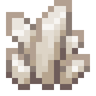
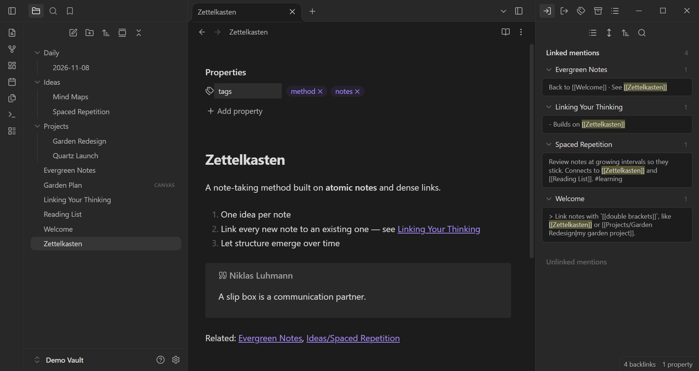
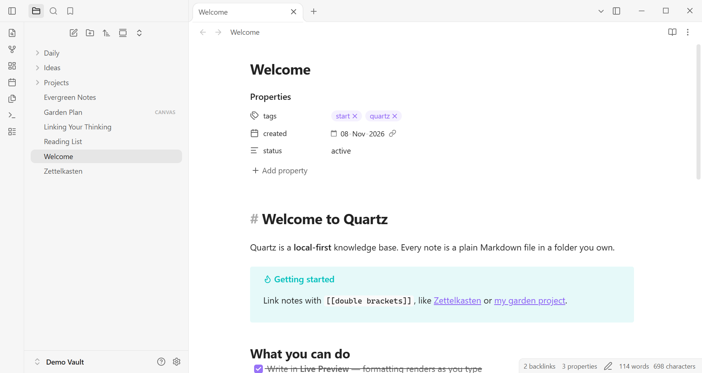
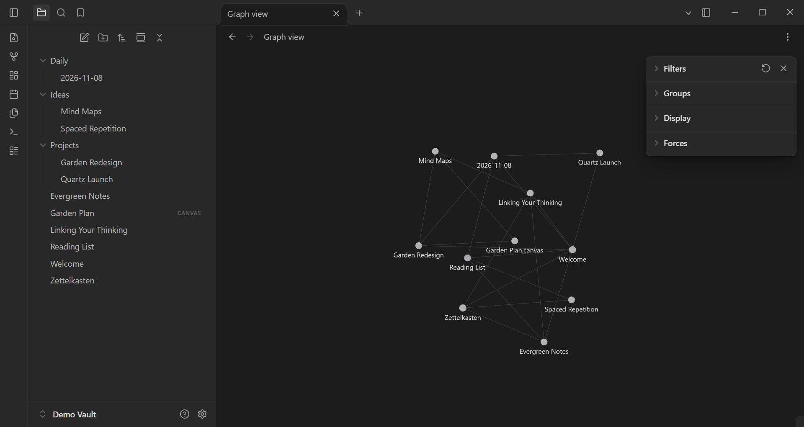
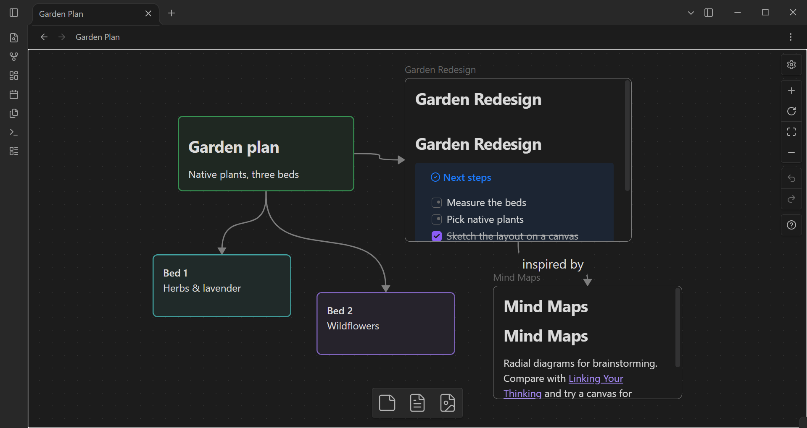
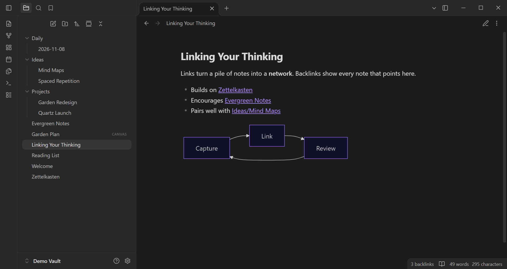
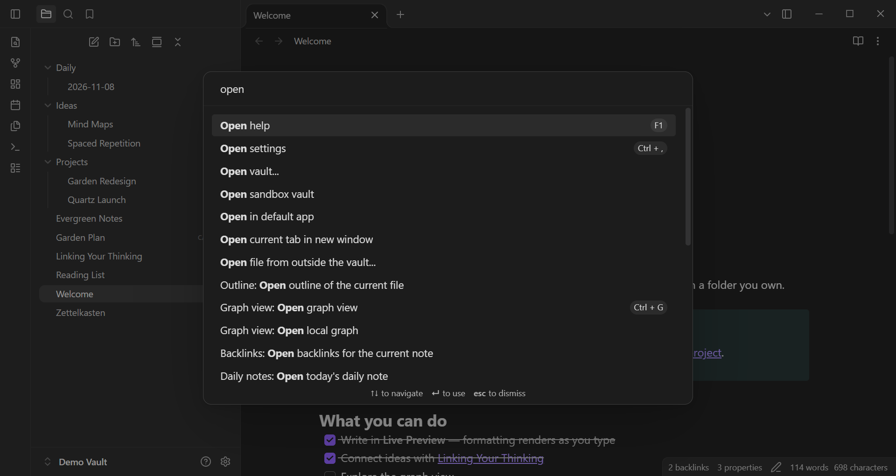

<h1 align="center">
  <br>
  Quartz
</h1>

<p align="center">
  <strong>A free and open-source alternative to Obsidian, for your local Markdown notes.</strong>
</p>

<p align="center">
  <a href="https://github.com/Quartz-Maker/Quartz/releases/latest"></a>
  <a href="LICENSE"></a>
  
  
</p>

<p align="center">
  <a href="#features">Features</a> •
  <a href="#screenshots">Screenshots</a> •
  <a href="#plugins--themes">Plugins &amp; themes</a> •
  <a href="#installation">Installation</a> •
  <a href="#building-from-source">Building from source</a> •
  <a href="#contributing">Contributing</a> •
  <a href="#license">License</a>
</p>

---

<p align="center">
  
</p>

Quartz is a fully open-source replacement for Obsidian. It works on a folder of plain Markdown files on your own disk, with no account, no telemetry and no lock-in. You get the workflow you already know: wikilinks, backlinks, graph view, canvas, Bases, Live Preview and a command palette, all under the MIT license.

**Quartz runs most of Obsidian's open-source community plugins out of the box.** It ships a compatible `obsidian` plugin API module, so plugins load straight from your vault's plugin folder without any changes. Community themes and CSS snippets work too.

> [!NOTE]
> Quartz is an independent project. It is not affiliated with, endorsed by or sponsored by Obsidian or Dynalist Inc. "Obsidian" is a trademark of its respective owner and is used here only to describe compatibility.

## Features

### ✍️ Editor
- **Three modes:** Source, **Live Preview** (formatting renders as you type) and Reading view
- CodeMirror 6 editor with folding, list indentation, smart paste (URLs and HTML to Markdown) and optional **Vim keybindings**
- Callouts, footnotes, `%%comments%%`, `==highlights==`, task lists, tables with inline table editing
- **Math** with MathJax, **diagrams** with Mermaid, syntax highlighting with Prism
- Link and embed suggester for `[[note]]`, `[[note#heading]]`, `[[note#^block]]` and `![[embeds]]`

### 🔗 Linking & knowledge graph
- Wikilinks and Markdown links, aliases, block references and embeds
- **Backlinks** (linked and unlinked mentions), **outgoing links**, **outline** and **tags** panes
- Links update automatically when you rename or move files
- **Graph view** and **local graph**, a GPU-accelerated force-directed layout with filters, groups and display controls
- Hover previews for links

### 🗂️ Workspace
- Tabs, split panes, pop-out windows and linked panes
- File explorer with drag-and-drop, sorting and context menus
- **Quick switcher**, **command palette** and fully customizable **hotkeys**
- **Full-text search** with a rich query language (`path:`, `tag:`, `line:`, `section:`, properties, regex) and embedded query blocks
- Bookmarks, workspaces, random note, word count and a status bar

### 🧩 Core plugins
Daily notes · Templates · Note composer · Slash commands · Unique note creator · Slides · Audio recorder · File recovery (snapshots) · Web viewer · Page preview · Footnotes · Properties

### 🧱 Canvas & Bases
- **Canvas:** an infinite whiteboard for notes, files, links and groups, stored as open [JSON Canvas](https://jsoncanvas.org) files
- **Bases:** database-style table, cards, list and kanban views built from your notes' frontmatter, with filters, formulas, sorting and grouping

### 📝 Properties
- Typed frontmatter properties (text, list, number, checkbox, date and date-time) with an inline editor

### 🎨 Appearance
- Light, dark and system themes, accent colour, fonts and zoom
- Community themes and **CSS snippets**
- Export notes to **PDF**

### 🔒 Local-first
- Your notes are ordinary `.md` files in a folder you control
- Per-vault configuration lives in a hidden `.quartz/` folder
- Multiple vaults, each in its own window, plus `quartz://` URIs for deep links

## Screenshots

<table>
  <tr>
    <td width="50%"><br><sub><b>Live Preview:</b> properties, callouts and links render as you type</sub></td>
    <td width="50%"><br><sub><b>Graph view:</b> see how your notes connect</sub></td>
  </tr>
  <tr>
    <td width="50%"><br><sub><b>Canvas:</b> lay out cards, notes and connections on an infinite board</sub></td>
    <td width="50%"><br><sub><b>Reading view:</b> with Mermaid diagrams, math and code</sub></td>
  </tr>
  <tr>
    <td width="50%"><br><sub><b>Command palette:</b> every action is a keystroke away</sub></td>
    <td width="50%"><br><sub><b>Backlinks:</b> linked mentions, with light and dark themes</sub></td>
  </tr>
</table>

## Plugins & themes

Quartz loads community plugins and themes from your vault's config folder:

```
<your-vault>/
└── .quartz/
    ├── plugins/<plugin-id>/   # manifest.json, main.js, styles.css
    ├── themes/<theme-name>/   # manifest.json, theme.css
    └── snippets/*.css
```

Open **Settings → Community plugins** to browse, install, enable and configure plugins. Plugins that depend on proprietary hosted services, such as Sync and Publish, are out of scope.

To make your existing plugins, themes and settings available, copy them from your vault's old config folder into `.quartz/`.

## Installation

Download the latest build for your platform from the [**Releases**](https://github.com/Quartz-Maker/Quartz/releases) page:

| Platform | Package |
|----------|---------|
| Windows  | `.exe` installer (NSIS) or portable `.zip` |
| Linux    | `.deb`, `.AppImage` or `.tar.gz` |
| macOS    | `.dmg` or `.zip` (Intel and Apple Silicon) |

> [!NOTE]
> macOS builds are not yet notarized. On first launch, right-click Quartz in Applications and choose **Open**.

**Debian/Ubuntu**
```bash
sudo apt install ./quartz_<version>_amd64.deb
```

> [!TIP]
> If Quartz fails to start on Linux with a sandbox error, your distribution may restrict unprivileged user namespaces. You can allow them with:
> `echo 0 | sudo tee /proc/sys/kernel/apparmor_restrict_unprivileged_userns`

## Building from source

**Prerequisites:** [Node.js](https://nodejs.org) 20 or newer and [pnpm](https://pnpm.io).

```bash
git clone https://github.com/Quartz-Maker/Quartz.git
cd Quartz
pnpm install
pnpm dev            # run in development mode with hot reload
```

Build packages:

```bash
pnpm build          # compile into out/
pnpm build:win      # Windows installer + zip
pnpm build:linux    # .deb, AppImage, tar.gz
pnpm build:mac      # macOS app
```

Packages are written to `dist/`.

## Tech stack

| Layer | Technology |
|-------|------------|
| Desktop shell | Electron |
| Language | TypeScript |
| Editor | CodeMirror 6 |
| Markdown | remark, mdast/hast, DOMPurify |
| Graph | d3-force + PixiJS |
| Math and diagrams | MathJax 4, Mermaid |
| Icons | Lucide |
| Build | electron-vite (Vite) and electron-builder |

## Project structure

```
src/
├── main/        # Electron main process: windows, vault registry, IPC, quartz:// protocol
├── preload/     # Preload bridge
└── renderer/
    └── src/
        ├── engine/   # App core: vault, metadata cache, workspace, editor, views, plugins, settings
        ├── shell/    # App boot and core plugin wiring
        └── core/     # Theme and snippet loaders, shared utilities
```

## Contributing

Contributions are welcome, whether bug reports, plugin-compatibility reports, documentation or code.

1. Fork the repository and create a branch: `git checkout -b feature/my-change`
2. Make your change and check that `pnpm build` passes
3. Open a pull request describing what changed and why

If a community plugin doesn't work in Quartz, please [open an issue](https://github.com/Quartz-Maker/Quartz/issues) with the plugin name, its version and what goes wrong.

## License

Quartz is released under the [MIT License](LICENSE).

Bundled third-party components keep their own licenses, including CodeMirror (MIT), HyperMD (MIT), MathJax (Apache-2.0), Lucide (ISC) and Inter (OFL-1.1).
